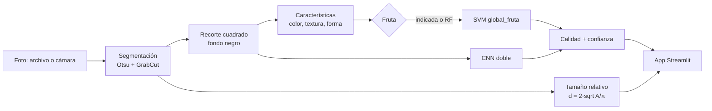

# Arquitectura del sistema

## Diagrama de bloques

## Módulos de `src/`

| Módulo | Responsabilidad |
|---|---|
| `config.py` | Rutas, semilla, frutas, clases y parámetros comunes |
| `data/descargar_datos.py` | Descarga del dataset de Kaggle |
| `data/inventario.py` | Inventario del dataset y medidas de cada imagen (EDA) |
| `data/segmentacion.py` | Máscara de la fruta (Otsu, GrabCut) y separación de frutas con watershed |
| `data/recortes.py` | Recorte cuadrado con fondo negro y partición train/val/test |
| `data/tamano.py` | Diámetro equivalente, normalización y categoría de tamaño |
| `data/propias.py` | Tamaño relativo y carga de las fotos propias |
| `features/extraccion.py` | 78 características de color, textura, forma y defectos |
| `models/clasicos.py` | Regresión logística, SVM y Random Forest con sus rejillas |
| `models/cnn.py` | CNN desde cero en Keras y su entrenamiento |
| `training/entrenar.py` | Búsqueda de hiperparámetros, CNN y análisis del sesgo de captura |
| `evaluation/evaluar.py` | Métricas, intervalos bootstrap y gráficas |
| `inference/predecir.py` | Clase `Clasificador`: de una foto a fruta, calidad y tamaño |

Los notebooks importan estos módulos; la lógica no se duplica.

## Flujo de la aplicación

1. `app/app_streamlit.py` recibe la imagen, corrige la orientación y la reduce a 1024 px.
2. `Clasificador.predecir` segmenta la fruta y la recorta.
3. Con el recorte se calculan las características. La fruta la indica el usuario o la detecta el Random Forest.
4. La SVM (o la CNN, si se elige) da la probabilidad de cada clase de calidad.
5. Se calcula el tamaño relativo con los umbrales por fruta del dataset.
6. La app muestra el contorno, el recorte, la calidad con su confianza, la fruta y el tamaño, y sugiere revisión humana si la confianza es menor a 0,70.

Los modelos se cargan una sola vez por sesión (`st.cache_resource`) desde `experiments/checkpoints/`.
